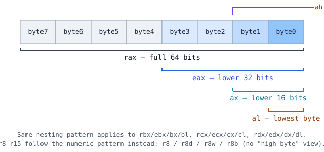
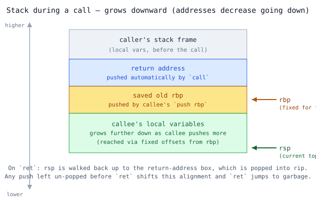

# x86-64 Register Cheatsheet (libasm / System V AMD64 ABI)

Quick reference for the 16 general-purpose registers, their sub-register
views, who's allowed to clobber what across a `call`, and how argument
passing differs between a normal function call and a raw `syscall`.

## 1. All 16 general-purpose registers and their sub-register views

| 64-bit | 32-bit | 16-bit | 8-bit (low) | 8-bit (high, legacy) |
|--------|--------|--------|-------------|-----------------------|
| rax    | eax    | ax     | al          | ah                    |
| rbx    | ebx    | bx     | bl          | bh                    |
| rcx    | ecx    | cx     | cl          | ch                    |
| rdx    | edx    | dx     | dl          | dh                    |
| rsi    | esi    | si     | sil         | —                     |
| rdi    | edi    | di     | dil         | —                     |
| rbp    | ebp    | bp     | bpl         | —                     |
| rsp    | esp    | sp     | spl         | —                     |
| r8     | r8d    | r8w    | r8b         | —                     |
| r9     | r9d    | r9w    | r9b         | —                     |
| r10    | r10d   | r10w   | r10b        | —                     |
| r11    | r11d   | r11w   | r11b        | —                     |
| r12    | r12d   | r12w   | r12b        | —                     |
| r13    | r13d   | r13w   | r13b        | —                     |
| r14    | r14d   | r14w   | r14b        | —                     |
| r15    | r15d   | r15w   | r15b        | —                     |

**Gotcha:** writing to a 32-bit view (`mov eax, 0`) zero-extends and clears
the *entire* upper 32 bits of the 64-bit register. Writing to the 16-bit or
8-bit view does **not** — it leaves the untouched upper bits exactly as they
were.

## 2. Special-purpose registers (not general scratch)

| Register | Job |
|---|---|
| `rip` | Instruction pointer — address of the next instruction. Not written directly with `mov`; changed implicitly by `jmp`, `call`, `ret`, and conditional jumps. |
| `rflags` | Status bits set by arithmetic/`cmp`/`test`: **ZF** (zero), **SF** (sign/negative), **CF** (unsigned carry/borrow), **OF** (signed overflow). Read implicitly by conditional jumps. |
| `rsp` | Stack pointer — always the address of the current top of stack. Never repurpose for scratch math. |
| `rbp` | Base/frame pointer — conventionally set once near function entry and left fixed for the rest of the function, as a stable reference for locals even as `rsp` moves. |

## 3. Caller-saved vs callee-saved (who's allowed to clobber what)

| Caller-saved ("volatile") | Callee-saved ("non-volatile") |
|---|---|
| `rax, rcx, rdx, rsi, rdi, r8, r9, r10, r11` | `rbx, rbp, r12, r13, r14, r15` |
| A function you call may clobber these freely. If you need the value after the `call`, **you** must save it (e.g. `push`/`pop` around the call). | If your function uses any of these, **you** must save the original value on entry and restore it before `ret` — the caller trusts it comes back untouched. |

**Free general-purpose scratch** (no fixed conventional job — only the
callee-saved *obligation* applies if you use them across a call):
`rbx, r12, r13, r14, r15`. Every other register already has a standing
role somewhere in the tables below.

## 4. Argument passing — normal function calls (System V AMD64 ABI)

| Arg # | 1 | 2 | 3 | 4 | 5 | 6 |
|---|---|---|---|---|---|---|
| Register | `rdi` | `rsi` | `rdx` | `rcx` | `r8` | `r9` |

Return value: **`rax`**. A 7th+ argument spills onto the stack (not needed
in this project).

## 5. Argument passing — syscalls (and exactly how it differs)

| Arg # | 1 | 2 | 3 | 4 | 5 | 6 |
|---|---|---|---|---|---|---|
| Register | `rdi` | `rsi` | `rdx` | **`r10`** | `r8` | `r9` |

Syscall number goes in **`rax`** *before* `syscall` executes; the return
value comes back in **`rax`** *after* it returns.

**The one difference that matters:** the 4th argument slot is `rcx` for a
normal `call`, but `r10` for a `syscall`. That's not arbitrary — the
`syscall` instruction itself uses `rcx` internally to save the return
address (where to resume in user space) and `r11` to save `rflags`, while
switching into kernel mode. Since `rcx` is busy doing that job during the
transition, it can't also carry your 4th argument, so the ABI substitutes
`r10` in that one slot specifically for syscalls. Practically: treat `rcx`
and `r11` as clobbered by any `syscall` instruction, the same way
caller-saved registers are treated around a `call`.

| | Function call | Syscall |
|---|---|---|
| Arg 1–3 | rdi, rsi, rdx | rdi, rsi, rdx (same) |
| Arg 4 | **rcx** | **r10** |
| Arg 5–6 | r8, r9 | r8, r9 (same) |
| Extra registers clobbered | (none beyond the caller-saved list) | `rcx`, `r11` (used internally by the instruction) |

## 6. push / pop / call / ret recap

- `push src` — `rsp -= 8`, then store `src` at `[rsp]`.
- `pop dest` — load `[rsp]` into `dest`, then `rsp += 8`.
- `call label` — pushes the return address (next instruction's address), then jumps to `label`.
- `ret` — pops the top of the stack into `rip`. Blindly trusts it's a valid return address — mismatched pushes/pops before `ret` means jumping to garbage.

## 7. Stack alignment reminder

`rsp` must be a multiple of 16 at the moment a `call` instruction executes.
Immediately *inside* a callee (right after entry), `rsp % 16 == 8` — the
`call`'s own 8-byte return-address push shifted it off the 16-boundary,
which is expected. Track your running push count if you `call` something
else from inside a function that already pushed things.
